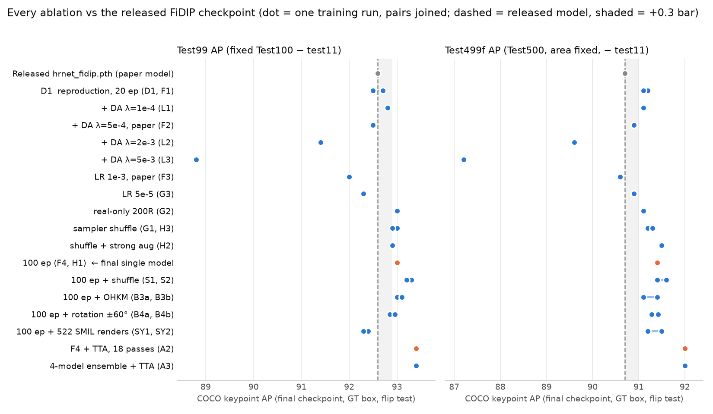
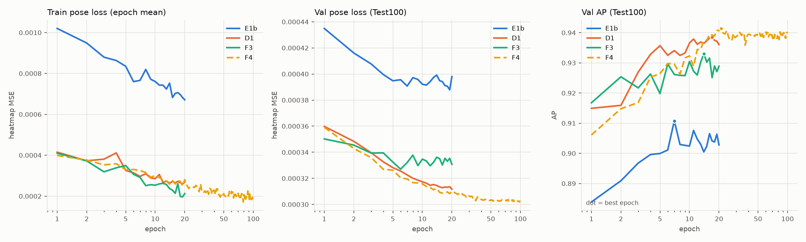
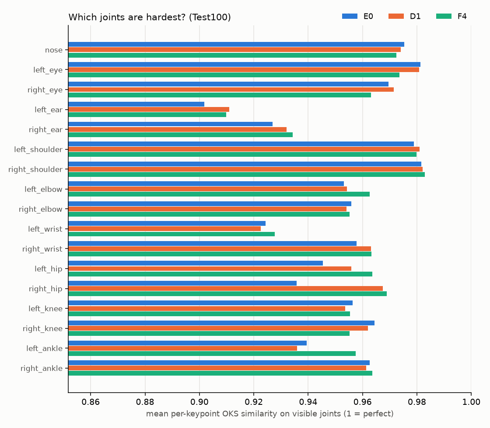
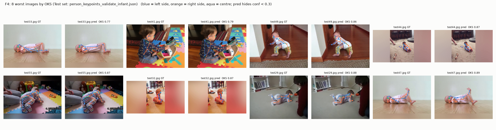
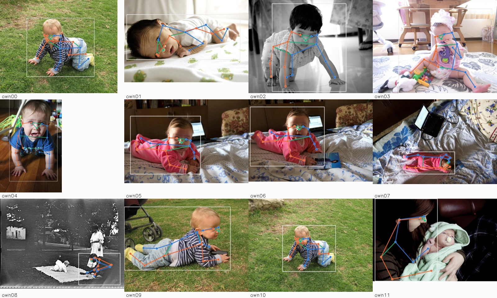
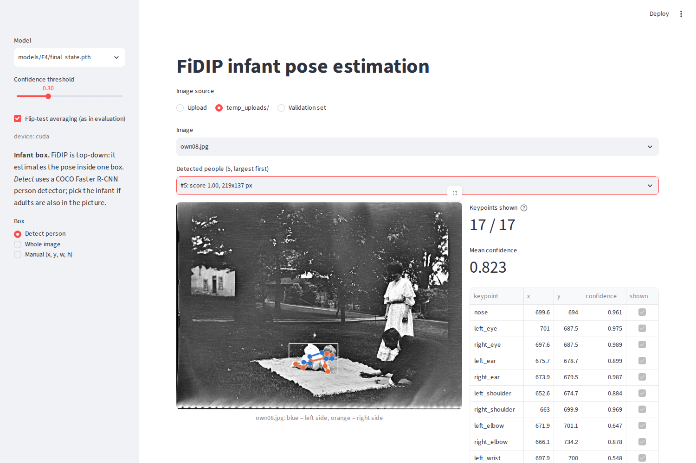
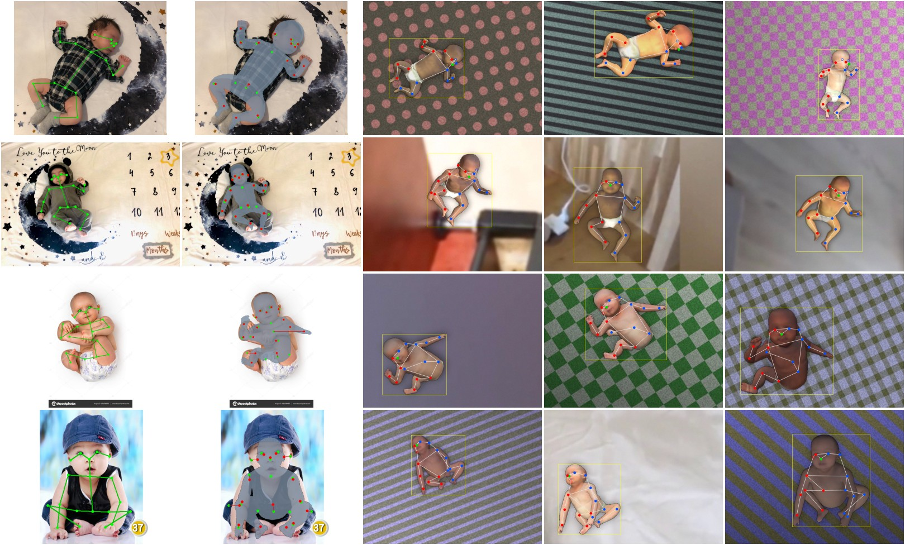

<!--
DRAFT, 2026-11-04. Open items before submission:
  [x] B4a/B4b finished (not confirmed); final model unchanged.
  [x] Annotation-audit branch merged into this branch; results, logs, figures and generated data tracked in git (2026-11-04).
  [ ] Merge this branch (claude/fidip-grading-rubric-86bb65) into main before submission.
  [ ] Fill in the name/ID line and the repo URL / commit hash below.
-->

# Reproducing and Improving FiDIP Infant Pose Estimation on SyRIP

**EECE 7373 hands-on project report** · Yuchen Hou · repository: `melonlala/Infant-Pose-Estimation` (private), commit `<fill in>`

Companion files at the repository root: [`AGENT.md`](AGENT.md) (lab notebook, every run and decision), [`MANIFEST.md`](MANIFEST.md)
(datasets, checkpoints, final-number provenance), [`SKILL.md`](SKILL.md) (cluster workflow used by the agent).

---

## 0. Summary

| | Test100 (paper protocol) | **Test99** (primary) | **Test499f** (secondary, 5× larger) |
|---|---|---|---|
| Published FiDIP (DarkPose + FiDIP, HRNet-W48, paper Table IV) | 93.6 | — | — |
| Released `hrnet_fidip.pth`, evaluated by us under identical conditions | 93.6 | 92.6 | 90.7 |
| Our reproduction **D1** (corrected labels, upstream config, 20 epochs) | 93.6 | 92.7 | 91.2 |
| **Our final single model F4** (D1 + 100 epochs), replicate H1 in brackets | **94.0** (93.9) | **93.0** (93.0) | **91.4** (91.4) |
| F4 + fixed test-time augmentation **A2** (flip × 3 scales × 3 rotations, 18 passes) | 94.4 | 93.4 | 92.0 |

All numbers are COCO keypoint AP (OKS), ground-truth person boxes, flip test, last-epoch checkpoint (`final_state.pth`), on the same SyRIP test images
the paper uses. Evaluation conditions are defined in §4.

1. **Reproduction.** The released checkpoint gives exactly the paper's 93.6 once one swapped test image is fixed. Retraining from the DarkPose COCO
   weights gives 93.6 too (D1, final checkpoint), but only after we found and fixed wrong labels on all 1000 synthetic training images in the
   training archive.
2. **Improvement.** One controlled change helped and was confirmed by a replicate: training 100 epochs instead of 20 (F4/H1). It gives +0.4 AP
   over the released model on Test99 and +0.7 on Test499f. A fixed test-time-augmentation grid adds a further +0.4 / +0.6.
3. **Negative results** (§6): domain adaptation (the "DIP" in FiDIP) does not help at any of 5 λ values once the labels are correct. The paper's
   LR of 1e-3 overfits. Real-only training matches real + synthetic. 522 new SMIL renders, OHKM loss, stronger rotation augmentation and a
   sampler-shuffle fix all fall inside run-to-run noise.

---

## 1. Implementation and environment (rubric: setup and data preparation)

### 1.1 Code and compute

- **Code:** official `ostadabbas/Infant-Pose-Estimation` @ `a76b4f4`, plus our commits (W&B logging, opt-in sampler shuffle, OHKM option, evaluation
  and visualisation tools, demos, SMIL port). The guide's `gpu_test.py`, `demo.py`, `streamlit_demo.py` and `fidip_simple.yml` exist in no public fork,
  so we wrote our own demos (§7).
- **Training/eval:** Northeastern Explorer cluster, Slurm, V100-SXM2-32GB (B4: A100-80GB). Conda prefix env `envs/fidip`: Python 3.12.16,
  PyTorch 2.3.1+cu121, built by `slurm/setup_env.sh`; package list in `fidip_env.yml`.
- **Server (analysis, demos, synthetic rendering):** 2× RTX 6000 Ada, `.venv-demo` (torch + yacs/streamlit/pycocotools), `.venv-smil` (pyrender EGL).
- **Workflow:** code lives in git on the server and is pushed to GitHub. The cluster gets code by `rsync` (`slurm/sync.sh push|pull|env`) and never uses
  git. Secrets (`WANDB_API_KEY`) live in a git-ignored `.env`. Curves go to TensorBoard and W&B (project `fidip`).

Environment problems we hit and fixed are logged in AGENT.md "Dead ends": the first training job died on `import torch.utils.tensorboard`, `wandb.util.generate_id`
was removed in wandb 0.31, a P100 runs out of memory at batch 20, the login node kills `pip`, and the cluster `/home` quota filled with unused
`feature.npy` dumps.

### 1.2 Data acquisition and a data audit

SyRIP was downloaded from the public AClab page (`syrip_for_train.zip`, `SyRIP.zip`; sha256 in MANIFEST §3). Before training on it we audited
images against labels (`tools/check_annotations.py`, overlays, and scoring a trusted model against each label set). We found four defects that matter:

| # | Defect | Evidence | Effect | Fix |
|---|---|---|---|---|
| 1 | **All 1000 synthetic training labels in `syrip_for_train` are wrong.** They are MINI-RGBD source poses (`image_source: MINI_dataset`, 13 visible kps, 640×480), not labels of the SyRIP renders | the released model's predictions match these labels at mean OKS 0.21, vs 0.62 for `SyRIP/annotations/1000S`; bbox IoU median 0.31; 46 also have wrong image sizes | half of every training batch has unlearnable targets | train JSON → `SyRIP/annotations/200R_1000S` (same images, correct labels; 200 real labels identical) |
| 2 | **`validate_infant/test11.jpg` is the wrong image** (byte-identical to `test24.jpg`) | GT is 1536×2048; the SyRIP copy matches it | released model drops from 93.6 to 92.1 | symlink the SyRIP copy |
| 3 | **Test500 has a constant `area` (2443298)** on every annotation | COCOeval uses GT area as the OKS scale | Test500 AP saturates at ~98.4 for every model | `area` = bbox w·h (`tools/make_syrip500_fixed.py`) |
| 4 | **4 Test100 images duplicate annotated training images** (test20/42/46/50) | md5 match | slight optimism | report Test95 as a leak-free check |

The corrected roots are symlink trees that leave the originals untouched: `data/syrip_fixed/` (train + Test100) and `data/syrip500_fixed/` (Test500).
All runs from D1 on use them.

**test11 is dropped from the reported numbers.** Its GT fits the correct image only loosely (hips, right leg and left ear are 50–90 px off), and every
model scores it OKS ≈ 1, so it inflates every model by the same ~1.0 AP. We still report Test100 *with* the corrected image, because that is the protocol
behind the paper's 93.6. Dropping it never changes the ranking of runs.

---

## 2. Method

### 2.1 Model (Part 3 notes: `docs/part3_model_notes.md`)

- **Pose network:** DarkPose HRNet-W48, 384×288 input, 17 heatmaps at 96×72, DARK (distribution-aware) coordinate decoding, 63.6 M parameters.
  It is initialised from DarkPose COCO weights (`models/coco/w48_384x288.pth`). The first 109 parameter tensors (stem through stage 2, 1.72 M = 2.7 %)
  are frozen.
- **Domain classifier (DC):** 0.75 M parameters on the 48×96×72 stage feature map. It predicts real vs synthetic.
- **FiDIP training:** each iteration alternates (I) updating the DC with the pose net fixed and (II) updating the pose net with
  `L = MSE_heatmap − λ · BCE_domain`, so the pose features are pushed to be domain-invariant. The `BalancedBatchSampler` builds 50/50 real/synthetic batches
  by oversampling the 200 real images.
- **Upstream config vs paper:** the shipped YAML has `LAMBDA 0.0` and `PRE_EPOCH 0`, which means DA is off and the plain upstream run is "DarkPose +
  Finetune", not FiDIP. It also uses LR 1e-4 and 20 epochs (paper: 1e-3, 100 epochs). We test each of these differences separately (§6).

### 2.2 Experimental protocol and implementation choices

- **One factor per run.** Every ablation changes exactly one setting relative to a named base (D1 or F4). Output directories are unique, and
  `slurm/submit_run.sh` refuses to reuse one, because AUTO_RESUME would otherwise silently continue another run.
- **Noise estimate first.** Replicates of the same config differ by 0.1–0.2 AP (D1 vs F1; F4 vs H1). We therefore use **+0.3 AP as the significance bar**.
- **Pre-registered decision rules.** Before each batch of runs we wrote down in AGENT.md the metric, the bar, and what would be adopted. The rule was then
  applied mechanically when the results came in. A change counts as *confirmed* only if a replicate pair clears the bar on average and neither run falls
  below the base.
- **Final checkpoint, not best epoch.** Upstream saves `model_best.pth` by Test100 AP, which selects on the test set. For 100-epoch runs this "best" was
  *worse* on Test500f than the last epoch (F4 91.0 vs 91.7). From the F-track on, every decision and every reported number uses `final_state.pth`.
- **Decision metric = Test499f.** It is 5× larger than Test99 and is never used inside the training loop.

---

## 3. Inference and evaluation pipeline (rubric: working pipeline)

| Component | File | Role |
|---|---|---|
| Training + per-epoch Test100 eval | `tools/train_adaptive_model_hrnet.py`, `slurm/train.sh`, `slurm/submit_run.sh` | train, then chain two Test500f evals (best, final) with `afterok` |
| Official evaluation | `tools/test_adaptive_model.py`, `slurm/eval.sh` | GT box, flip test, COCO keypoint eval |
| Subset rescoring | `tools/eval_subsets.py` | rescores saved prediction JSONs on Test100 / Test99 / Test95 / Test500f / Test499f with pycocotools (no re-inference) |
| Ensemble + TTA | `tools/eval_ensemble_tta.py`, `slurm/eval_ens.sh` | averages heatmaps over models and over scale/rotation views, warps them back, then applies the same DARK decoding and evaluation. Its identity setting reproduces the official eval (A0: 93.99 / 91.73 vs official 94.0 / 91.7) |
| Single-image inference | `tools/fidip_infer.py` | shared by visualisation, demos, video; optional Faster R-CNN person detector |
| Visualisation | `tools/visualize_preds.py`, `tools/plot_curves.py`, `tools/plot_compare.py`, `tools/plot_report_ablation.py` | GT vs prediction grids, per-joint OKS, training curves, Fig. 1 |

**Evaluation conditions (identical for every row in this report):** SyRIP real test images; GT person boxes (`TEST.USE_GT_BBOX True`), as in the paper; flip test;
COCO OKS AP averaged over thresholds 0.50:0.95 with the standard COCO sigmas; the same code path for the released model and ours.

| Subset | Definition | Use |
|---|---|---|
| Test100 | paper's test set, corrected `test11.jpg` | comparison with the paper's 93.6 |
| **Test99** | Test100 − test11 | primary |
| Test95 | Test99 − 4 train duplicates | leak-free check |
| Test500f | Test500 with area = bbox area (⊃ Test100) | larger set |
| **Test499f** | Test500f − test11 | decision metric |

---

## 4. Reproduction of the published baseline

| Run | What | Test100 | Test99 | Test499f |
|---|---|---|---|---|
| Paper | DarkPose + Finetune / DarkPose + FiDIP (Table IV) | 92.7 / **93.6** | — | — |
| E0 | released `hrnet_fidip.pth`, original data (swapped test11) | 92.1 | — | — |
| D0 | released `hrnet_fidip.pth`, corrected data | **93.6** (AP50 98.5, AP75 98.5, AR 94.6) | 92.6 | 90.7 |
| E1b | upstream config on the original (broken) training labels | 92.6 | 91.6 | 89.6 |
| E1c | E1b replicate | (90.8 on the swapped-test11 set) | — | — |
| **D1** | upstream config on corrected labels, 20 ep | 93.6 final (93.8 best epoch) | 92.7 | 91.2 |
| F1 | D1 replicate | 93.5 | 92.5 | 91.1 |

- The **released checkpoint reproduces the paper exactly** (93.6, with identical AP50/AP75/AR) once test11 is fixed. Our initial 1.5-AP "environment
  gap" was this single image.
- **Retraining reproduces the paper too, but only on corrected labels.** On the shipped `syrip_for_train` labels the same config loses 1.0–1.6 AP.
- Our D1 run is "DarkPose + Finetune" in the paper's terms (λ = 0). It matches the paper's FiDIP number, which is 0.9 higher than the paper's own Finetune
  number. The DA experiments in §6.1 show why: in this code, DA adds nothing once the labels are right.

---

## 5. Final configuration and improvement over the baseline (rubric: comparison with baseline; bonus)

### 5.1 Result

**Final single model: F4** = upstream config on `data/syrip_fixed`, `TRAIN.END_EPOCH 100` (LR 1e-4, ×0.1 drop at epoch 40 as in the upstream schedule), last
checkpoint. Replicate H1 is identical within 0.1 on every subset.

| Model | Test100 | Test99 AP / AP50 / AP75 / AR | Test95 | Test499f AP / AP50 / AP75 / AR |
|---|---|---|---|---|
| Released (paper model) | 93.6 | 92.6 / 97.5 / 97.5 / 94.5 | 92.8 | 90.7 / 98.7 / 95.7 / 92.2 |
| **F4** | **94.0** | **93.0** / 97.4 / 97.4 / 95.1 | **93.2** | **91.4** / 98.8 / 96.7 / 92.9 |
| H1 (F4 replicate) | 93.9 | 93.0 / 97.4 / 97.4 / 95.1 | 93.2 | 91.4 / 98.8 / 96.7 / 92.8 |
| A2 = F4 + TTA (18 forward passes/person) | 94.4 | 93.4 / 97.4 / 97.4 / 95.5 | 93.6 | 92.0 / 98.8 / 96.7 / 93.4 |
| A3 = {F4, H1, S1, S2} ensemble + TTA (72 passes) | 94.4 | 93.4 / 97.4 / 97.4 / 95.5 | 93.6 | 92.0 / 98.8 / 96.7 / 93.6 |

**Paired bootstrap over test images** (1000 resamples, same images for both models; this measures test-sample uncertainty, while the replicate pairs
above measure training noise):

| Comparison | Test99 Δ AP [95 % CI] | Test499f Δ AP [95 % CI] |
|---|---|---|
| F4 − released | +0.5 [−0.1, +1.2] | **+0.7 [+0.2, +1.3]** |
| A2 − released | **+1.0 [+0.2, +1.8]** | **+1.3 [+0.7, +1.9]** |

On the 99-image set the single-model gain is directionally consistent but its CI touches zero. On the 499-image set it is clearly above zero.

### 5.2 Where the gain comes from (controlled comparison)

| Step | Single change | Test99 | Test499f | Evidence |
|---|---|---|---|---|
| Released model | — | 92.6 | 90.7 | — |
| D1/F1 mean | retrain with upstream config on corrected labels | 92.6 | 91.15 | 2 runs |
| **F4/H1 mean** | **+ 80 more epochs (only `END_EPOCH` changed)** | **93.0** | **91.4** | 2 runs, spread 0.0 |
| A2 | + fixed TTA grid at inference | 93.4 | 92.0 | deterministic; A0 = F4 verifies the tool |
| A3 | + 4-model ensemble | 93.4 | 92.0 | ensemble adds +0.08 at 4× cost |

- The **100-epoch** change is the only training change that was confirmed by its pre-registered rule (pair mean final Test500f 91.65 ≥ 91.5, both ≥ 91.2).
  It was hypothesised before running: D1's validation AP was still rising at epoch 16 of 20.
- **TTA** was pre-registered with a fixed grid (scales 0.9/1.0/1.1 × rotations −30°/0°/+30° × flip) that was not tuned. Among the 3 listed TTA/ensemble
  configs, the rule picked the best (A3). A2 is within 0.1 at a quarter of the cost, so we recommend A2 as the deployed system.
  We think TTA helps here because lying infants appear at any rotation, so averaging over rotated views reduces orientation-dependent errors.

### 5.3 Is this test-set tuning?

SyRIP ships **no validation split**: the paper and the upstream code select epochs on Test100. We reduced test-set selection as much as the data allows.
We never used `model_best` for decisions. We chose all hyperparameters by one-factor hypotheses written down before each run. We decided on Test499f
with a pre-set bar, and we confirmed with replicates. We did not touch any threshold, grid or augmentation after seeing its result. The remaining
exposure is that the *choice among* ~25 pre-registered configurations was made on the test sets. The +0.3 bar plus replicates guard against picking a
lucky run, but this is not a clean held-out evaluation. A cleaner protocol would carve a validation split out of the 200 real training images (§9).

---

## 6. All improvement attempts (rubric: quantitative evaluation)



*Figure 1. One dot per training run, final checkpoint. Replicate pairs are joined. Dashed line: the released checkpoint. Shaded band: the +0.3 significance
bar. Orange: adopted. `tools/plot_report_ablation.py`.*

### 6.1 Full table (final checkpoint; Test499f is the decision metric)

| ID | Change (vs base) | Test100 | Test99 | Test95 | Test500f | **Test499f** | Verdict |
|---|---|---|---|---|---|---|---|
| D1 / F1 | base: corrected labels, 20 ep | 93.6 / 93.5 | 92.7 / 92.5 | 92.9 / 92.7 | 91.4* / 91.2 | 91.2 / 91.1 | reproduction; noise 0.1–0.2 |
| L1 | + DA λ 1e-4 | 93.7 | 92.8 | 92.9 | 91.4 | 91.1 | no gain |
| F2 | + DA λ 5e-4 (paper) | 93.5 | 92.5 | 92.8 | 91.0 | 90.9 | no gain |
| L2 | + DA λ 2e-3 | 92.4 | 91.4 | 91.7 | 89.6 | 89.6 | worse |
| L3 | + DA λ 5e-3 | 89.7 | 88.8 | 89.3 | 87.3 | 87.2 | much worse |
| F3 | LR 1e-3 (paper) | 92.9 | 92.0 | 92.1 | 90.6 | 90.6 | worse, overfits |
| G3 | LR 5e-5 | 93.3 | 92.3 | 92.5 | 91.0 | 90.9 | slightly worse |
| G2 | real-only 200R, matched iterations | 93.9 | 93.0 | 93.1 | 91.3 | 91.1 | = real + syn |
| G1 / H3 | sampler reshuffles each epoch | 94.0 / 93.9 | 93.0 / 92.9 | 93.2 / 93.1 | 91.5 / 91.3 | 91.2 / 91.3 | not confirmed |
| H2 | shuffle + stronger aug (rot 60°, scale 0.45) | 93.9 | 92.9 | 93.0 | 91.6 | 91.5 | single run |
| **F4 / H1** | **100 epochs** | **94.0 / 93.9** | **93.0 / 93.0** | **93.2 / 93.2** | **91.7 / 91.6** | **91.4 / 91.4** | **confirmed** |
| S1 / S2 | 100 ep + shuffle | 94.3 / 94.2 | 93.3 / 93.2 | 93.5 / 93.4 | 91.5 / 91.7 | 91.4 / 91.6 | not confirmed (trend +0.1–0.3) |
| B3a / B3b | 100 ep + OHKM (top-8 joints) | 94.0 / 94.1 | 93.0 / 93.1 | 93.2 / 93.3 | 91.5 / 91.2 | 91.4 / 91.1 | not confirmed |
| B4a / B4b | 100 ep + rotation ±60° (A100) | 93.8 / 94.0 | 92.9 / 93.0 | 93.0 / 93.1 | 91.4 / 91.6 | 91.3 / 91.4 | not confirmed |
| SY1 / SY2 | 100 ep + 522 new SMIL renders (§7.1) | 93.2 / 93.1 | 92.4 / 92.3 | 92.6 / 92.4 | 91.7 / 91.5 | 91.5 / 91.2 | no effect on Test499f; −0.6 Test99 |
| A1 | ensemble {F4,H1,S1,S2}, flip only | 94.2 | 93.2 | 93.4 | 91.8 | 91.5 | below bar |
| **A2** | F4 + TTA | 94.4 | 93.4 | 93.6 | 92.2 | **92.0** | adopted (system) |
| A3 | ensemble + TTA | 94.4 | 93.4 | 93.6 | 92.2 | 92.0 | ≈ A2 at 4× cost |
| M0 | released `mobile_fidip.pth` | 79.2 | 78.2 | 77.9 | 69.8 | 69.7 | backbone reference |
| M1 / M2 | MobileNetV2 224², corrected labels, 20 / 100 ep | 74.7 / 79.4 | 74.0 / 78.6 | 73.9 / 78.3 | 69.2 / 73.2 | 69.0 / 73.1 | M2 > released by +3.4 Test499f |

\* D1 has only a `model_best` Test500f eval. Runs on the original broken labels (E1b, E1c, E2) are excluded because they are not comparable.

### 6.2 What each result means

- **Domain adaptation does not help with correct labels.** We swept λ over {0, 1e-4, 5e-4, 2e-3, 5e-3}. The adversarial term works as designed:
  domain-classifier accuracy falls from 0.78 to 0.54 (chance) as λ grows. But pose AP falls with it. With wrong synthetic labels (E2) DA also did nothing.
  We could not reproduce the paper's +0.9 from Finetune to FiDIP. Possible reasons: the per-iteration I/II alternation, the code's LR 1e-4, or the paper's
  Finetune baseline being trained on the defective labels.
- **Learning rate:** 1e-3 (paper) overfits: lowest train loss, val loss rising after epoch 6, val/train ratio 1.56 vs 1.16. 5e-5 slightly underfits.
  1e-4 is the sweet spot.
- **Synthetic data adds nothing measurable for HRNet-W48.** Real-only (G2) ties real + synthetic at matched iterations, and 522 extra SMIL renders do not help
  on Test499f and cost 0.6 on Test99. The paper's Table III gain from synthetic data was measured with a weaker backbone (ResNet-50) and possibly with the defective labels.
- **Longer training helps a little, and much more for MobileNet** (+4.1 Test499f). A 224² MobileNet is far from converged after 20 epochs.
  HRNet-W48 beats MobileNetV2 by 14–18 AP. Its AP50 is ≥ 96 either way, so the gap is localisation precision (56² vs 96×72 heatmaps), not missed joints.
- **Shuffle** is a bug fix: the stock sampler reuses the same batch order and the same real-image oversampling every epoch. All 4 shuffled runs are ≥
  their unshuffled twins on Test99, but the gain (+0.1–0.3) never cleared the bar. We report it as a trend.

---

## 7. Visualisation and failure analysis (rubric: visualisations and analysis)

### 7.1 Training curves: diagnosing fit (Part 4.5, `docs/part4_results_and_fitting.md`)



*Figure 2. Train loss, val loss and val AP for E1b (broken labels), D1, F3 (LR 1e-3) and F4 (100 ep).*

| Run | Train loss first → last | Val/train loss | Best val AP @ epoch | Diagnosis |
|---|---|---|---|---|
| E1b | 1.02e-3 → 6.7e-4 | **0.59** | 0.911 @ 7 | label noise: val loss below train loss for the whole run |
| D1 | 4.2e-4 → 2.7e-4 | 1.16 | 0.938 @ 17 | healthy; still improving at the end |
| F3 | 4.1e-4 → 2.1e-4 | 1.56 | 0.933 @ 14 | overfitting (val loss rises after epoch 6) |
| F4 | 4.0e-4 → 1.9e-4 | 1.58 | 0.941 @ 21 | benign plateau: val loss keeps creeping down, AP flat at 0.94 |

Our first reading of E1b ("mild overfitting onset") was wrong, and we corrected it once the label defect was found. A whole run with val loss below train
loss is a red flag for label noise, not just a side effect of augmentation.

### 7.2 Per-joint accuracy and worst cases



*Figure 3. Mean per-joint OKS similarity on Test100 for the released model (E0), D1 and F4.*



*Figure 4. F4's 8 worst Test100 images, GT (left) next to the prediction.*

- **Where F4 gains:** hips (left 0.945 → 0.964, right 0.936 → 0.969), left ankle (0.940 → 0.957), left elbow. These joints are ambiguous on a chubby
  infant body and are often hidden by clothes. **Where nothing helps:** ears stay the weakest joint (0.90–0.93) for every model.
- **The same images are worst for every model:** test33 (side-lying, limbs overlapping) and test41 (sitting, seen from behind, arms hidden by a toy).
  Both are **self-occlusion**, which none of our changes address. OHKM, which targets hard *joints*, did not help, because the error sits on hard *images*.
- **AP50 ≈ AP75 ≈ 97–99 for every HRNet model.** The remaining error is fine localisation on a handful of images, not gross failures.

### 7.3 Demos and in-the-wild images (Part 6, `docs/part6_demos.md`)



*Figure 5. F4 on 12 Wikimedia Commons infant photos that are not in SyRIP (`temp_uploads/SOURCES.md`), with the person-detector box.*

- `tools/demo.py` (CLI) and `tools/streamlit_demo.py` (web UI: upload, model picker, threshold, person picker). Both were run for real, and the Streamlit app
  was driven with headless Chromium.
- **The box matters more than the model:** on real photos, mean keypoint confidence is 0.77 with the whole image as the box and 0.86 with a detected box.
  We added a Faster R-CNN person detector for this reason. F4 is more confident than the released model on 11 of 12 images.
- **Failure modes:** the detector picks an adult as the "largest person" (fixed with a picker), swaddled infants, strong foreshortening, and side-view occlusion.



*Figure 6. Streamlit demo: 5 people detected, the infant selected, 17/17 keypoints.*

### 7.4 Extensions

- **7.3 Video / webcam** (`tools/video_infer.py`): file, folder batch, or webcam. It tracks the box from the previous frame's keypoint hull and writes an
  annotated mp4 plus jsonl/csv. On 3 synthetic pan/zoom clips with known GT, tracking beats the whole-frame box by +0.010 to +0.024 mean OKS. Speed is
  ~20 fps with flip and 32 fps without (RTX 6000 Ada). See `docs/part7_synthetic_and_apps.md` and `figures/video/track_frames.jpg`.
- **7.1 Synthetic generation with SMIL** (`syn_generation/tools/`, `docs/part7_synthetic_and_apps.md`):
  - We converted the licensed SMIL model from chumpy to numpy and ported the OpenDR renderer (not installable on Python ≥ 3.10) to pyrender EGL.
  - We fitted SMIL to all 200 real training images (median reprojection error 2.1 % of the box diagonal) and kept 174 fits. Rendering 3 variants each
    gives 522 images, with label checks: 0 keypoints out of bounds, left/right consistent with the 3D body in 445/445 cases.
  - Finding: SMIL hip joints sit inside the pelvis, at 0.39× the annotated hip width. A calibrated 2.8 cm offset cuts cross-validated hip error from 6.0 % to 3.8 %.
    The original 1000S set has narrow hips too, which may be one reason it helps little.
  - Training on these renders (SY1/SY2) had no measurable effect (§6).



*Figure 7. Real image → SMIL fit → new synthetic renders with labels.*

---

## 8. Reproducibility

All paths in this report are relative to the repository root. The cluster copy (`/home/hou.yuchen/courses/eece7373`) and the server copy have the same layout.
MANIFEST §7–8 lists every checkpoint and log.

### 8.1 What is in the repository

| Path | Contents |
|---|---|
| `tools/`, `slurm/`, `lib/`, `experiments/`, `syn_generation/` | all code: training, evaluation, TTA, rescoring, visualisation, demos, SMIL pipeline, Slurm scripts |
| `logs/fidip-<run>-<jobid>.out` | Slurm stdout of every job (104 files), including the per-epoch AP tables |
| `log/<run>/` | TensorBoard events for every training run (input to `tools/plot_curves.py`, `tools/plot_compare.py`) |
| `output/<run>/syrip/adaptive_pose_*/<cfg>/` | per-run train log and final Test100 predictions `results/keypoints_validate_infant_results_0.json` |
| `output_test500f/<run>[_final]/...` | Test500f predictions and eval logs (`_final` = `final_state.pth`); `output_test500/` = the superseded constant-area evals |
| `figures/` | every figure in this report (`figures/report/` = Fig. 1) plus all curves, prediction grids, demo outputs and video clips |
| `temp_uploads/` | the 12 in-the-wild photos used in §7.3, with licences in `SOURCES.md` |
| `data/syrip_syn_new/` | our 522 SMIL renders + COCO annotations, `render_meta.json`, `label_check.json` (§7.4) |

**Not in the repository:**
- **SyRIP** (images and annotations): download it from the AClab page; sha256 sums are in MANIFEST §3. Then rebuild the corrected symlink roots
  (`data/syrip_fixed`, `data/syrip500_fixed`, …) with the scripts below.
- **Checkpoints** (`*.pth`, 0.25 GB each): on the cluster under `output/<run>/…/final_state.pth`.
- **The licensed SMIL model.**

Every AP in this report can be recomputed without a GPU from the tracked prediction files once SyRIP is downloaded and the corrected roots are built:
`python tools/eval_subsets.py D0_E0:E0 D1 F1 F4 H1 ENS_A2` and `python tools/report_stats_bootstrap.py 1000`.

### 8.2 Commands

```bash
# 1. environment + data (once)
sbatch slurm/setup_env.sh          # conda env, lib/nms build, model downloads, GPU check
sbatch slurm/unpack_data.sh        # syrip_for_train.zip -> data/syrip
bash tools/make_syrip_fixed.sh     # data/syrip_fixed: correct synthetic labels + correct test11 (symlinks)
python tools/make_syrip500_fixed.py  # data/syrip500_fixed: Test500 with real areas

# 2. released-model baseline (D0)
sbatch slurm/eval.sh models/hrnet_fidip.pth DATASET.ROOT data/syrip_fixed/ OUTPUT_DIR output/D0_E0

# 3. reproduction (D1-equivalent) and final model (F4); each also chains Test500f evals of best and final
bash slurm/submit_run.sh F1 01:00:00
bash slurm/submit_run.sh F4 02:45:00 TRAIN.END_EPOCH 100

# 4. TTA system (A2)
F4=output/F4/syrip/adaptive_pose_hrnet/w48_384x288_adam_lr1e-3_infant/final_state.pth
sbatch slurm/eval_ens.sh $F4 0.9,1.0,1.1 -30,0,30 output/ENS_A2 DATASET.ROOT data/syrip_fixed/                 # Test100
sbatch slurm/eval_ens.sh $F4 0.9,1.0,1.1 -30,0,30 output_test500f/ENS_A2_final DATASET.ROOT data/syrip500_fixed/  # Test500f

# 5. score every subset (server, after `bash slurm/sync.sh pull`)
.venv-demo/bin/python tools/eval_subsets.py D0_E0:E0 D1 F1 F4 H1 ENS_A2
```

- **Config:** `experiments/coco/hrnet/w48_384x288_adam_lr1e-3_infant.yaml` (upstream, unchanged). Every deviation is a command-line override recorded
  per run in the AGENT.md summary table, together with its Slurm job IDs.
- **Final checkpoint:** `output/F4/syrip/adaptive_pose_hrnet/w48_384x288_adam_lr1e-3_infant/final_state.pth` (Slurm 11603343; replicate H1 11607648).
  A copy is on the server at `models/F4/final_state.pth`. Checkpoints are not in git (size).
- **Logs (in the repo):** F4's training is in `logs/fidip-F4-11603343.out` and `log/F4/`, its Test100 predictions in
  `output/F4/syrip/adaptive_pose_hrnet/w48_384x288_adam_lr1e-3_infant/results/`, and its Test500f predictions in `output_test500f/F4_final/`.
  The same layout holds for every run. W&B project `fidip` mirrors the curves (runs are named by ID).
- **Repeats:** D1/F1, F4/H1, G1/H3, S1/S2, B3a/b, B4a/b and SY1/SY2 are replicate pairs.
- **Exact reproduction caveat:** cuDNN is non-deterministic, so expect ±0.2 AP between reruns. B4 ran on A100 (TF32 convolutions) rather than V100.

---

## 9. Limitations

1. **No validation split** (§5.3). Configuration choice touched the test sets. Pre-registration, final checkpoints and replicates reduce but do not remove the bias.
2. **Small test sets.** Test99 has 99 images, so 1 AP ≈ one hard image. The single-model gain over the released model is significant on Test499f but not on
   Test99 (bootstrap CI includes 0). Test500 ⊃ Test100, so the two sets are not independent.
3. **Only 2 runs per confirmed config.** With noise ≈ 0.2, effects of ~0.1–0.3 (shuffle, OHKM, stronger aug) cannot be resolved without more replicates.
4. **Data-fix dependence.** Our numbers hold on the corrected data. We do not know which labels the authors trained the released model on, so
   "released vs ours" compares two models under the same evaluation, not two identical training pipelines.
5. **test11 decision.** Dropping it is our judgement call. We report Test100 with it for paper comparability.
6. **DA not reproduced** at any λ. We did not try other alternation schedules or DC architectures.
7. **Synthetic generation is limited:** no LSUN backgrounds, 12 textures, top-down views only, and poses that copy the real ones with jitter.
8. **GT boxes at test time,** as in the paper. In-the-wild use needs a detector, and the box matters more than the model (§7.3).

## 10. Lessons learned

- **Audit the data before tuning the model.** The two largest effects in the whole project were data bugs: the swapped test11 (1.5 AP on the released model)
  and the wrong synthetic labels (1.0–1.6 AP on retraining). Every hyperparameter change we tried moved AP by less.
- **Measure noise first, and write the rule before seeing the result.** Several apparently good single runs (G1 +0.3, H2 +0.4) disappeared on replication.
- **"Best epoch on the test set" is a trap.** On 100-epoch runs it picked a worse model than simply taking the last epoch.
- **Cheap inference-time ensembling (TTA) beat every training-time change,** and it is orthogonal to them.
- **Infrastructure fails quietly:** an SSH timeout does not mean a job wasn't submitted, a sync push can revert a teammate session's files mid-submission,
  argparse reads `-30` as a flag, and `/home` quota fills with unused dumps. Each of these is now a rule in AGENT.md or SKILL.md.

## 11. Use of AI tools

The project was run as an agentic workflow with **Claude Code** (Anthropic), as required by Part 0 of the guide. The full record is in `AGENT.md`.

- **What the agent did:** built the environment and Slurm scripts; submitted, monitored and summarised ~60 cluster jobs; wrote the evaluation,
  visualisation, TTA, demo, video and SMIL-porting code; ran the data audit; drafted the docs and this report from the logs. Several sessions ran in
  parallel on separate git worktrees (e.g. the annotation audit and the λ/MobileNet/TTA tracks), coordinated through AGENT.md and MANIFEST.md.
- **Where I stepped in:**
  - I independently found and built the corrected data root (`syrip_fixed`, D-track) while the agent was still investigating.
  - I made the judgement calls: drop test11, retrain on the corrected labels, download the licensed SMIL model, train on the new renders, delete
    cluster files to free quota, and move jobs to the lab's A100 partition.
  - I asked for the pre-registered stop-and-ask rules, so the agent could not keep launching runs on its own.
- **Agent mistakes we caught and logged:**
  - It logged the first training job as "queued" without checking; the job had actually died at import.
  - Its first over/underfitting diagnosis was wrong (it was label noise).
  - A `sync.sh push` from one session silently reverted another session's cluster scripts, so two MobileNet runs were submitted as HRNet. They were
    held before starting.
  - A TTA eval failed on argparse parsing `-30` as a flag.
  Every number in this report was re-derived from saved prediction files (`tools/eval_subsets.py`), not copied from agent summaries.
- **This report** was drafted by the agent from AGENT.md, MANIFEST.md and the result files, and then reviewed and edited by me.

## References

1. X. Huang, N. Fu, S. Liu, S. Ostadabbas. *Invariant Representation Learning for Infant Pose Estimation with Small Data.* IEEE FG 2021. arXiv:2010.06100.
2. F. Zhang, X. Zhu, H. Dai, M. Ye, C. Zhu. *Distribution-Aware Coordinate Representation for Human Pose Estimation* (DarkPose). CVPR 2020.
3. K. Sun, B. Xiao, D. Liu, J. Wang. *Deep High-Resolution Representation Learning for Human Pose Estimation* (HRNet). CVPR 2019.
4. N. Hesse et al. *Learning an Infant Body Model from RGB-D Data for Accurate Full Body Motion Analysis* (SMIL). MICCAI 2018.
5. G. Pavlakos et al. *Expressive Body Capture: 3D Hands, Face, and Body from a Single Image* (SMPLify-X). CVPR 2019.
6. Y. Ganin et al. *Domain-Adversarial Training of Neural Networks.* JMLR 2016.
7. T.-Y. Lin et al. *Microsoft COCO: Common Objects in Context.* ECCV 2014 (keypoint OKS metric).
8. SyRIP dataset: https://coe.northeastern.edu/Research/AClab/SyRIP/ · code: https://github.com/ostadabbas/Infant-Pose-Estimation
9. Anthropic, Claude Code: https://claude.com/claude-code
